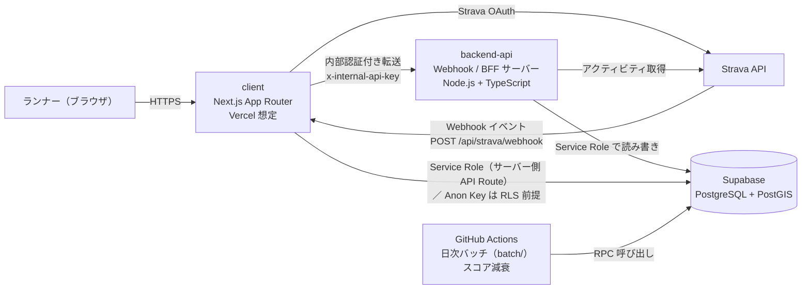

# strava-hex-turf

**Strava と H3 六角タイルでつくる、ランナー向けの陣取り Web アプリ**

走ったルートを六角タイル（Uber H3、Resolution 7）の「陣地」として可視化し、招待制のグループ内で仲間と奪い合うゲームです。ランニングのコース開拓と継続的な運動モチベーションを高めることを目的としています。

> **開発ステータス（正直な現状）:** 本サービスは開発中であり、**一般公開はしていません**。現時点では Strava アプリの接続アスリート数の上限は**開発者本人 1 人のみ**で、第三者は利用できません。一般公開と Strava API の制限引き上げ申請に向けた残件は [docs/launch-checklist.md](docs/launch-checklist.md) にまとめています。

---

## 1. サービス概要

- **誰のための何か:** Strava でランニングを記録しているランナーが、普段の走行ルートを「陣地」として可視化し、同じグループの仲間と奪い合いを楽しむための Web アプリです。
- **仕組みの核:** Strava にアクティビティをアップロードすると、Webhook 経由で自動的に処理され、通過したエリアの H3 タイル（Resolution 7、一辺約 1.2 km、面積約 5 km²）の所有権が移ります。手動で陣地を登録する操作は不要です。
- **参加形態:** グループは招待コード制です。タイル・ランキング・Activity Log は、**同一グループのメンバー内でのみ**表示されます（詳細は「8. Strava API の利用目的」と [docs/strava-api-application.md](docs/strava-api-application.md) を参照）。
- 詳細な仕様は [docs/srd.md](docs/srd.md)（プロダクト要件定義書）を参照してください。なお SRD には将来構想も含まれており、本 README の「機能一覧」は**実装済みのものだけ**を記載します。

## 2. 遊び方・ゲームの仕組み

1. **Strava と連携する** — ログイン画面から Strava OAuth で連携します。初回連携時は、過去 7 日分のアクティビティを取り込んでタイルに反映します（初回バックフィル）。
2. **グループを作る／参加する** — グループを作成すると招待コードが自動発行されます。仲間は招待コードを入力して参加します。**ユーザーがいずれかのグループに所属していないと、Webhook でタイルは書き込まれません。**
3. **走る** — Strava にアクティビティ（対象種目: `Run` / `TrailRun` / `VirtualRun`）がアップロードされると Webhook で通知され、バックエンドが GPS（`summary_polyline`）から通過タイルを算出して所有権を即時に移します。すでに自分のタイルを走れば「防衛」となり、スコアが 100% にリセットされます。
4. **スコア減衰** — タイルのスコアは獲得・防衛から 30 日かけて 100 → 0 に線形に減衰し、地図上の色が薄くなります。減衰は GitHub Actions の日次バッチ（DB の RPC `decay_tile_scores`）で更新されます。
5. **グループ対戦** — 同じグループのメンバー同士でタイルを奪い合います。他のメンバーにタイルを走られると所有権は即時に移ります。
6. **ランキング** — グループごとに、メンバー内のランキング（獲得タイル数・スコア等の集計を DB の RPC で実施）を表示します。
7. **Activity Log** — 「誰がどこを奪取／防衛したか」などの履歴を、グループ内タイムラインとして表示します。

## 3. 機能一覧（実装済みのみ）

| 機能 | 状態 | 補足 |
| --- | --- | --- |
| Strava OAuth ログイン | 実装済み | OAuth `state` の検証、セッション Cookie（署名付き JWT）を含む |
| Webhook による自動タイル獲得／防衛 | 実装済み | アクティビティの作成・更新・削除、連携解除（deauthorization）イベントに対応 |
| 初回バックフィル | 実装済み | 初回連携時に過去 7 日分を取り込む。内部キーによる実行制御あり |
| 陣取りマップ | 実装済み | MapLibre GL JS + OpenStreetMap タイル上に H3 タイルをスコアの濃さで表示。所属グループのタイル取得とグループ別表示 |
| グループ作成・参加・退会・削除 | 実装済み | 招待コード制。参加試行の失敗が続いた場合のロック（5 回失敗で 15 分）を含む |
| ランキング（リーダーボード） | 実装済み | グループ内のみ表示 |
| Activity Log | 実装済み | グループ内の奪取・防衛等の履歴表示 |
| ユーザー成績推移（日次統計） | 実装済み | 日次スナップショット（`user_group_daily_stats`）とバックフィル用バッチ |
| スコア減衰バッチ | 実装済み | GitHub Actions で毎日実行 |
| プライバシーゾーンによる除外 | **バックエンド実装済み／UI 未実装** | ゾーンが設定されている場合にその内側のタイルを獲得対象から除外する仕組みをバックエンドに実装済み（`backend-api/src/utils/privacy-zone.ts`、Webhook 処理に組み込み済み）。**ゾーン設定用 UI は今後対応予定**であり、現状ユーザーが画面からゾーンを設定する手段はありません |
| アカウント削除 | 実装済み | 設定画面から実行可能。Strava 連携の解除も試行し、関連データを削除する（詳細は [docs/privacy-policy.md](docs/privacy-policy.md)） |
| 多言語対応（日本語／英語） | 実装済み | next-intl、`client/messages/ja.json`・`en.json` |
| プライバシーポリシー／利用規約ページ | 実装済み | アプリ内ページ（`/privacy`、`/terms`）。文書版は [docs/privacy-policy.md](docs/privacy-policy.md) |

**実装していないもの（SRD の将来構想等）:** 年末・月末のシェア画像生成、毎年 1 月 1 日の全体リセット、プライバシーゾーン設定 UI は、いずれも現時点では実装していません。本 README では「ある」とは書きません。

## 4. アーキテクチャ



- **client（Next.js）**: UI、Strava OAuth のコールバック、Webhook の受付（購読確認と `subscription_id` の真正性検証を行い、backend-api へ内部認証付きで転送）、グループ／タイル／ランキング等の API Route。
- **backend-api**: Webhook 処理（アクティビティ取得、GPS → H3 変換、妥当性検証、プライバシーゾーン除外、タイル／ログの書き込み、連携解除時のユーザー削除）と BFF エンドポイント（ユーザー同期、グループ作成・参加、初回バックフィル）。
- **Supabase**: ユーザー、グループ、タイル所有権、Activity Log 等の永続化。Row Level Security（RLS）を有効化しています。
- **GitHub Actions バッチ**: `batch/` のスコア減衰処理を毎日（15:00 UTC = 日本時間翌日 0:00）実行します。

## 5. 技術スタック

| 領域 | 技術 |
| --- | --- |
| フロントエンド | Next.js 15（App Router）、React 18、Tailwind CSS、next-intl、MapLibre GL JS（@vis.gl/react-maplibre）、h3-js、Recharts |
| バックエンド | Node.js、TypeScript、Vitest、@mapbox/polyline、h3-js |
| データベース | Supabase（PostgreSQL + PostGIS）、マイグレーションは SQL ファイル + Supabase CLI で管理 |
| バッチ | Node.js + TypeScript、GitHub Actions（cron） |
| インフラ | Vercel（client のホスティング想定）、Terraform（`infra/`、Vercel / Supabase のプロビジョニング構想） |
| セッション／暗号 | jose（署名付き JWT セッション）、AES-256-GCM（Strava トークンの暗号化） |

Node.js 18 以上を推奨します（GitHub Actions のバッチは Node.js 20 で実行）。

## 6. リポジトリ構成

| ディレクトリ | 内容 |
| --- | --- |
| `client` | フロントエンド（Next.js App Router, React, Tailwind CSS） |
| `backend-api` | バックエンド API / Webhook サーバー（Node.js, TypeScript）。仕様は `backend-api/openapi.yaml` |
| `batch` | 定期実行処理（スコア減衰、日次統計バックフィル） |
| `supabase` | Supabase マイグレーション（SQL） |
| `infra` | Terraform（Vercel / Supabase 等） |
| `docs` | 仕様書・ポリシー・申請関連ドキュメント |
| `scripts` | 運用補助スクリプト（初回バックフィル実行等） |

### 何から始めればいいか

| 目的 | 参照先 |
| --- | --- |
| フロントエンドを動かす | [client/README.md](client/README.md) |
| データベース（Supabase）を用意する | [supabase/README.md](supabase/README.md) |
| バックエンド API の開発・テスト | [backend-api/README.md](backend-api/README.md) |
| 定期実行バッチ | [batch/README.md](batch/README.md) |
| インフラ（Terraform） | [infra/README.md](infra/README.md) |
| 仕様・要件の確認 | [docs/README.md](docs/README.md)、[docs/srd.md](docs/srd.md) |
| プライバシーポリシー（文書版） | [docs/privacy-policy.md](docs/privacy-policy.md) |
| 公開・申請に向けた残件 | [docs/launch-checklist.md](docs/launch-checklist.md) |
| Strava API 申請文面の下書き | [docs/strava-api-application.md](docs/strava-api-application.md) |

## 7. セットアップ手順

### 前提

- Node.js 18 以上
- Supabase プロジェクト（PostgreSQL + PostGIS）と Supabase CLI
- Strava API アプリ（[Strava Developers](https://developers.strava.com/) で登録し、Client ID / Client Secret を取得）

### 手順

1. **依存関係のインストール** — 各ディレクトリ（`client`、`backend-api`、`batch`）で `npm install`。
2. **Supabase マイグレーションの適用** — 初回のみリポジトリルートで `make db-link PROJECT_REF=<プロジェクトID>` で紐付け、その後 `make db-push` で `supabase/migrations/` の全マイグレーションを適用します（詳細は [supabase/README.md](supabase/README.md)）。
3. **環境変数の設定** — `client/.env.example` → `client/.env.local`、`backend-api/.env.example` → `backend-api/.env.local` をコピーし、下表の値を設定します。
4. **起動** — backend-api で `npm run build && npm run webhook-server`（デフォルト `http://localhost:3001`）、client で `npm run dev`（`http://localhost:3000`）。
5. **Webhook 購読の作成** — Strava は公開 URL を要求するため、ローカル検証では ngrok 等で公開し、client で `npm run webhook:subscribe` を実行します。表示された購読 ID を `STRAVA_WEBHOOK_SUBSCRIPTION_ID` に設定します（手順の詳細は [client/README.md](client/README.md)）。

> **⚠ マイグレーション改名に伴う既存 DB 向け repair 手順:** RLS マイグレーションは旧名 `20250303120000_enforce_rls.sql` から `20260303120000_enforce_rls.sql` へ改名されています（旧名ではファイル名順で初期スキーマより前に並び、新規環境で失敗するため）。**既存 DB** では `schema_migrations` に旧バージョンが残っているため、適用時に次で履歴を付け替えてください（内容自体は同一です）。新規 DB では不要です。
>
> ```bash
> supabase migration repair --status reverted 20250303120000
> supabase migration repair --status applied 20260303120000
> ```
>
> 出典: `supabase/migrations/20260303120000_enforce_rls.sql` 冒頭コメント。

### 環境変数一覧

#### client（`client/.env.local`）

| 変数 | 必須 | 説明 |
| --- | --- | --- |
| `SESSION_SECRET` | 必須 | セッション Cookie の署名用（32 文字以上のランダム文字列） |
| `NEXT_PUBLIC_STRAVA_CLIENT_ID` | 必須 | Strava アプリの Client ID |
| `STRAVA_CLIENT_SECRET` | 必須 | Strava アプリの Client Secret |
| `NEXT_PUBLIC_APP_URL` | 必須 | アプリのベース URL（末尾スラッシュなし）。本番は HTTPS の公開 URL |
| `NEXT_PUBLIC_SUPABASE_URL` | 必須 | Supabase Project URL |
| `NEXT_PUBLIC_SUPABASE_ANON_KEY` | 必須 | Supabase `anon` キー |
| `SUPABASE_SERVICE_ROLE_KEY` | 必須 | Supabase `service_role` キー。**サーバー側でのみ使用し、公開・コミット禁止** |
| `STRAVA_TOKEN_ENCRYPTION_KEY` | 必須 | Strava トークンの暗号化鍵（32 バイトの base64）。未設定では Strava ログインが失敗します。backend-api と同一の値にすること |
| `STRAVA_WEBHOOK_VERIFY_TOKEN` | 必須（Webhook 利用時） | Webhook 購読確認用トークン。購読作成時に Strava API へ渡す値と同一にすること |
| `STRAVA_WEBHOOK_SUBSCRIPTION_ID` | **必須** | Webhook POST の真正性検証用。受信ペイロードの `subscription_id` と照合し、未設定・不一致のイベントは backend へ転送しません（fail closed） |
| `INTERNAL_API_KEY` | **必須** | backend-api への内部呼び出し用共有キー（backend-api の `INTERNAL_API_KEY` と同一の値）。`x-internal-api-key` ヘッダで送ります |
| `INTERNAL_BACKFILL_API_KEY` | 必須（初回バックフィル利用時） | 初回バックフィル用の従来キー（backend-api と同一の値） |
| `BACKEND_API_URL` | **必須** | backend-api の URL（末尾スラッシュなし）。**本番では必ず `https` の URL を設定すること**（平文 http では Strava トークン等が経路上で漏洩するおそれがあります） |
| `STRAVA_WEBHOOK_CALLBACK_URL` | 任意 | Webhook の callback_url をフル URL で上書きする場合のみ |

#### backend-api（`backend-api/.env.local`）

| 変数 | 必須 | 説明 |
| --- | --- | --- |
| `SUPABASE_URL`（または `NEXT_PUBLIC_SUPABASE_URL`） | 必須 | Supabase Project URL |
| `SUPABASE_SERVICE_ROLE_KEY` | 必須 | Supabase `service_role` キー |
| `STRAVA_TOKEN_ENCRYPTION_KEY` | 必須 | トークンの暗号化・復号用（client と同一の値）。未設定では保存を拒否し、復号失敗時は Webhook 処理を停止します |
| `INTERNAL_API_KEY` | **必須** | 内部 API 認証用共有キー（client と同一の値）。全 POST エンドポイントで照合し、未設定の場合は全リクエストを拒否します（fail closed） |
| `INTERNAL_BACKFILL_API_KEY` | 任意（後方互換） | 初回バックフィル用の従来キー |
| `PORT` | 任意 | Webhook サーバーの待ち受けポート（デフォルト 3001） |

## 8. Strava API の利用目的

本サービスは Strava API を、陣取りゲームの提供のためだけに利用します。スコープごとの取得データ・利用目的・保持／削除方針は [docs/README.md](docs/README.md) の「Strava OAuth スコープ別 データ取得・利用・保持ポリシー」表が正本であり、要約は次のとおりです。

| Scope | 取得データ | 利用目的 | 保持 / 削除方針 |
| --- | --- | --- | --- |
| `read` | アスリートの公開プロフィール（表示名、プロフィール画像、Strava athlete ID） | ログイン中ユーザーの識別、グループ表示名・アイコン表示、ランキング表示 | Supabase に保存。アカウント削除時に削除 |
| `activity:read` | 公開アクティビティのメタデータ・GPS（距離、時刻、緯度経度系列） | H3 タイルの奪取／防衛判定、スコア計算、Activity Log 表示 | ゲーム進行に必要な範囲で保存。アカウント削除時に活動由来データ（タイル履歴・ログ）を削除 |
| `activity:read_all` | 非公開アクティビティを含むアクティビティデータ | 現在要求しています。Webhook で受け取るアクティビティには非公開のものも含まれ、それらも陣取り判定の処理対象になるためです。あわせて `privacy_zone` が設定されている場合は、そのゾーン内の H3 セルを領地化対象から除外します | ゲーム進行に必要な範囲で保存（プライバシーゾーン内のセルは保存しない）。アカウント削除時に活動由来データを削除 |

補足（実装実態）:

- 実際の認可ルート（`client/app/api/auth/strava/login/route.ts`）で要求するスコープ文字列は `read,activity:read_all` です。
- GPS については、アクティビティの `summary_polyline` を処理時にデコードして H3 セルへ変換します。**生の GPS 系列（ポリライン）そのものはデータベースに保存せず**、保存するのは H3 インデックス、タイル所有権、スコア、`activity_tiles`（アクティビティとタイルの対応）、Activity Log 等の派生データです。
- 表示範囲: タイル、ランキング、Activity Log はいずれも**同一グループのメンバー内でのみ**表示される設計です。
- 第三者への販売・貸与・マーケティング目的の共有はしません。詳細は [docs/privacy-policy.md](docs/privacy-policy.md) を参照してください。

> **既知の不整合（要修正）:** アプリ内プライバシーポリシーページの文面（`client/messages/ja.json`・`en.json` の `privacy` / `login`）には「`activity:read_all` は現在要求していません」等の記述が残っており、上表（実装実態）とは一致していません。公開・申請前に文面を実態へ合わせて修正する必要があります（[docs/launch-checklist.md](docs/launch-checklist.md) 参照）。本 README と `docs/README.md` は実装実態に合わせて記載しています。

## 9. セキュリティ対策の要約

今回のセキュリティ修正で実装した主な対策です。

| 対策 | 内容 |
| --- | --- |
| 内部認証 | client → backend-api の全 POST エンドポイントで共有キー `INTERNAL_API_KEY` を `x-internal-api-key` ヘッダで照合（定数時間比較）。未設定の場合は全リクエストを拒否する fail closed 設計 |
| Webhook 真正性検証 | Strava Webhook POST には署名がないため、受信ペイロードの `subscription_id` を `STRAVA_WEBHOOK_SUBSCRIPTION_ID` と照合し、未設定・不一致のイベントは backend へ転送しない（fail closed）。購読確認 GET は `STRAVA_WEBHOOK_VERIFY_TOKEN` と `hub.verify_token` を照合 |
| 連携解除の真正性 | deauthorization イベントでは Strava ペイロードの `updates.authorized` を backend へ転送し、backend 側で `false` を確認してからユーザーを削除 |
| RLS（Row Level Security） | 全対象テーブルで RLS を有効化。最終状態は `20260407000000_security_hardening.sql` が保証します:`activity_tiles` は anon / authenticated の権限を取り消し、`tiles` の全件 SELECT ポリシーを削除（タイル取得はセッション＋メンバーシップ検証を行う API Route 経由のみ）、SECURITY DEFINER 関数の EXECUTE は `service_role` のみに制限 |
| トークン暗号化 | Strava のアクセス／リフレッシュトークンは AES-256-GCM で暗号化してから DB に保存。平文保存の経路はなく、鍵未設定時は保存を拒否し、復号失敗時は Webhook 処理を停止 |
| アクティビティの妥当性検証 | Webhook 処理で athlete ID と `owner_id` の照合、対象種目の制限、手動／トレーナーアクティビティの除外、速度の上限チェック、ポリライン経路長と `distance` の乖離チェックを実施。不正・異常なアクティビティはタイル化しません |
| 冪等性 | `activity_tiles` を用いて同一アクティビティの再処理を判定し、二重のタイル化・ログ生成を防ぎます。アクティビティ削除時は対応するタイルを再計算します |
| OAuth / セッション | Strava OAuth の `state` を Cookie と照合して検証。セッションは `SESSION_SECRET`（32 文字以上必須）で署名した JWT |
| グループ参加の保護 | 招待コードの照合はバックエンド経由で行い、同一ユーザーの参加失敗が 5 回続くと 15 分間ロックします |
| プライバシーゾーン除外 | `users.privacy_zone` が設定されている場合、その内側の H3 セルを領地化対象から除外し、ゾーン内のセルは保存しません（バックエンド実装済み。設定 UI は今後対応予定） |

## 10. 開発ステータスと公開に向けた残件

- **現在の状態:** 開発中。一般公開はしていません。Strava アプリの接続アスリート数の上限は開発者本人 1 人のみです。
- **公開・申請に向けて残っていること:** 本番ドメインの確定、backend-api の常時稼働ホスティングと HTTPS 化、Supabase への全マイグレーション適用と RLS 状態の確認、Strava Brand 準拠（公式ボタン・帰属表示等）、スクリーンショット等の申請素材の準備など。項目の一覧は [docs/launch-checklist.md](docs/launch-checklist.md) を参照してください。
- **申請文面:** [docs/strava-api-application.md](docs/strava-api-application.md)（下書き。提出は行っていません）。

## スクリーンショット・デモ

**準備中** — スクリーンショットおよびデモはまだ用意していません。撮影・追加は [docs/launch-checklist.md](docs/launch-checklist.md) の「申請素材」で管理しています。

## ライセンス / 連絡先

- 本リポジトリに関する問い合わせ・不具合報告は GitHub の Issues をご利用ください。
- 本サービスは Strava 社が提供・保証するものではありません。Strava データの取り扱いは [docs/privacy-policy.md](docs/privacy-policy.md) を参照してください。
